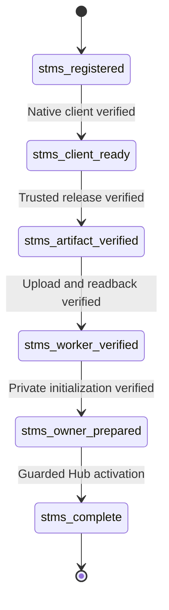

# Data Model: STMS account and workspace management

- **Feature:** [006-account-workspace-management](spec.md).
- **Date:** 2026-11-07.

## Records

| Record | Fields and constraints |
|---|---|
| `accounts` | Existing `id`, `owner_login_id`, `created_at`; add `name`, `name_search`, `status`, `revision`, `updated_at`. Unique holder. Existing labels may be null only pending explicit review; new records require nonblank labels. |
| `workspaces` | `id` references `organization.id`; unique `account_id`; `status`, `revision`, `region_hint`, `name_search`, `created_at`, `updated_at`. Name remains in `organization.name`; owners remain in `member.role`. |
| `workspace_creations` | `id`; unique `workspace_id`; `initiator_login_id`, `attempt_login_id`, `attempt_session_id`, `attempt_revision`, `phase`, `worker_name`, `origin`, `release_id`, `client_id`, `credential_envelope`, `error_code`, `completed_at`, `created_at`, `updated_at`. Allocation identifiers are immutable. |
| `audit_entries` | Add nullable `account_id`, `workspace_id`, `details`. Validate `details` for the specific action; preserve all existing rows unchanged. |

- **Types:** IDs use the existing UUID text convention; revisions are nonnegative integers; times are UTC strings. New tables are strict and references use the existing restricted-delete rules.
- **Statuses:** account/workspace status is `stms_active` or `stms_suspended`; status is independent of setup progress.
- **Session reference:** `attempt_session_id` is a private authorization reference, not a credential and not a foreign key that could prevent normal session deletion.
- **Secrets:** an unfinished creation retains its encrypted envelope. A completed creation has `completed_at`, phase `stms_complete` and no staging credential envelope.

## Creation phases

- **Failure:** retain the last verified phase and set a safe `error_code`; the screen shows Needs attention. Resume reconciles that phase instead of assuming the previous call failed.
- **Completion:** insert placement/address records, finish ownership, record the audit and set completion in the same Hub batch. KV publication follows; KV cannot grant access.
- **Changed authority:** handover or suspension invalidates stale attempts. Immutable resource allocation is retained for an authorized resume.

## Migration and retained test data

- **Preflight:** inspect retained development/test records. Report actual conflicts or missing required facts; do not assume they exist.
- **Schema:** use new, additive, interruption-safe migrations. Preserve native tables, IDs and released migrations.
- **Existing rows:** map only missing names, links or ownership facts on rows we retain, with explicit review. Empty stores need no mapping.
- **Constraints:** new records must satisfy the ownership, state and label rules. Unresolved retained rows must not be silently treated as complete.
- **No extra subsystem:** add no general adoption UI or framework. Do not reset data without separate approval.
- **History:** record any approved correction without inventing original creation history.
