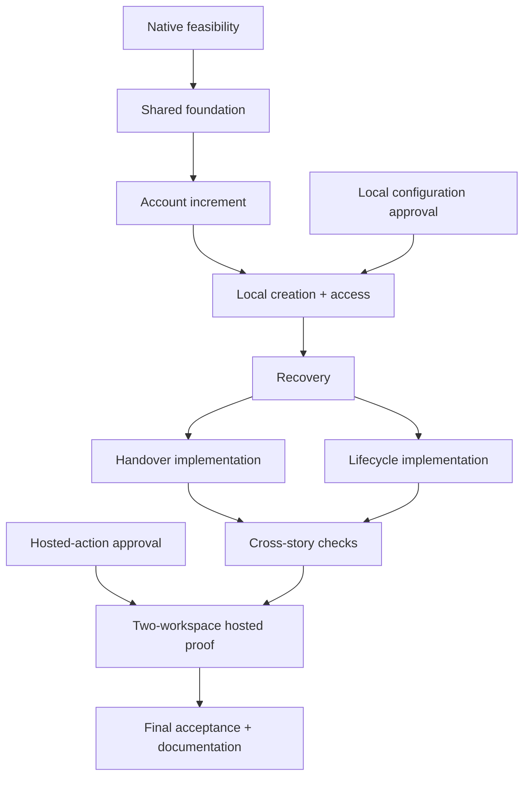

# Tasks: STMS account and workspace management

- **Input:** [specification](spec.md), [plan](plan.md), [data model](data-model.md), [contracts](contracts/) and [validation guide](quickstart.md).
- **Scope:** implement the approved plan, with all tasks initially unchecked. IDs belong to this feature's ledger; they are separate from the existing production T064.
- **Approval:** task approval does not authorize unreviewed code/configuration changes or remote actions.
- **Tests:** behavioral tests are required by this specification. Use real identity and storage; replace only external services in local failure tests.
- **Parallel work:** `[P]` marks disjoint work that can run together after its prerequisites.
- **Environment gate:** pending hosted approval must not block independent local work.

## Phase 1: Native proofs and environment approval

- [x] T001 Prove the installed Better Auth client-generation hooks, lost-registration-reply recovery and usable unchanged credentials in real workerd; record observed results and limitations in `specs/006-account-workspace-management/research.md`. Use disposable probes, not a substitute authentication implementation.
- [x] T002 Prove native Workflow instance deduplication, durable checkpoints and restart behavior in workerd; record results in `specs/006-account-workspace-management/research.md`. Do not infer hosted upload or isolation success from this local proof.
- [ ] T003 Prepare and obtain separate approval for exact platform/local-test configuration, provider permissions, owned test-domain routing and remote actions; cover `apps/platform/wrangler.jsonc`, affected existing Wrangler/test configurations and `scripts/release-config.ts`, recording approved targets in `docs/RELEASING.md`. Preserve existing Worker identities and production T064.

## Phase 2: Shared foundation

- [x] T004 [P] Implement a bounded, read-only retained-data preflight in `apps/hub/scripts/account-workspace-preflight.ts`; identify actual duplicate holders or missing required mappings without guessing names, reassigning ownership, deleting data or building a general adoption framework.
- [x] T005 [P] Add migration behavior tests in `apps/hub/src/db/account-workspace.test.ts` for empty stores, retained rows, conflicts, interrupted/repeated upgrades and preservation of native records and immutable audit history.
- [x] T006 Implement the approved fields in `apps/hub/src/db/migrations/2026-11-07-010000-account-workspaces.ts` and `apps/hub/src/db/hub.db.ts`. Enforce "Unique holder," unique account/workspace and workspace/creation links, "new records require nonblank labels," "revisions are nonnegative integers," "times are UTC strings," strict new tables and restricted-delete references. Preserve nullable existing labels only pending explicit review. Statuses are `stms_active` or `stms_suspended`; `attempt_session_id` must not prevent session deletion. Allocation identifiers are immutable; completion requires `completed_at`, `stms_complete` and no staging envelope. Add nullable audit references/details without rewriting old rows. Use the existing “UUID text convention”; an unfinished creation retains its encrypted envelope.
- [x] T007 Define strict shared operation inputs, minimal results, safe errors and public exports in `packages/stms/src/management/input.ts`, `packages/stms/src/management/operations.ts`, `packages/stms/src/index.ts` and `packages/stms/src/server/index.server.ts`. Keep `operationId` separate from request IDs; reject unknown fields and undeclared output data.
- [x] T008 Implement guarded business/audit commits and operation-result lookup in `packages/stms/src/management/changes.db.ts` and `packages/stms/src/management/operations.db.ts`, with behavior tests in `packages/stms/src/management/operations.test.ts`. Cover atomic rollback, concurrent duplicate keys, changed-input key reuse, fresh authority and recorded-result recovery; absence of a result must not imply an in-flight write cannot commit.
- [x] T009 Expose the read-only operation-status lookup through `apps/hub/src/functions/management-operations.functions.ts` and `apps/hub/src/functions/management-operations.server.ts`, with authorization tests in `apps/hub/src/functions/management-operations.test.ts`. Reuse existing master/request protections; deny ordinary holders, tenant admins, expired sessions and stale actors.

- **Dependencies:** T006 follows T004–T005; T007 → T008 → T009. T004 and T005 can run together. T003 gates configuration-dependent and hosted work, not local account development.
- **Verification checkpoint:** T005–T009 have targeted runtime proof, including standalone native-D1 rollback, operation recovery and actual HTTP requests through the production-mode local Hub bundle. Full Workers, browser, CLI, type and Hub build checks pass. At that T009 checkpoint, T003 approvals, T010 onward and hosted acceptance remained open. See the [HTTP evidence and limits](quickstart.md#operation-status-http-verification-t009); the account checkpoint follows below.

## Phase 3: Manage accounts — User Story 1 (P1)

- **Independent check:** create, find, inspect and rename an account through STMS; its holder and identity stay unchanged, and no workspace membership is created.

- [x] T010 [P] [US1] Add behavior tests in `packages/stms/src/accounts/accounts.test.ts` and `apps/hub/src/functions/accounts.test.ts` for Create, Refuse conflicts, and Find and rename. Cover duplicate/concurrent holders, inactive or archived holders, blank/repeated names, paging, failed loads, stale revisions, audits and unchanged unrelated records.
- [x] T011 [P] [US1] Add browser scenarios in `tests/e2e/accounts.spec.ts` for the account journey, keyboard operation, validation, session return, changed actor and direct non-master refusals. Reuse real sign-in and the existing isolated browser wrapper.
- [x] T012 [US1] Implement account DTOs, validated list/search inputs and indexed reads in `packages/stms/src/accounts/accounts.ts`, `packages/stms/src/accounts/input.ts` and `packages/stms/src/accounts/accounts.db.ts`. Use default page size 25, maximum 100, stable newest-first ordering and distinct empty/error outcomes.
- [x] T013 [US1] Implement create and rename in `packages/stms/src/create-account/create-account.server.ts`, `packages/stms/src/create-account/create-account.db.ts`, `packages/stms/src/rename-account/rename-account.server.ts` and `packages/stms/src/rename-account/rename-account.db.ts`, with inputs in `packages/stms/src/create-account/input.ts` and `packages/stms/src/rename-account/input.ts`. Reuse guarded saves and operation IDs; creating adds no membership, and renaming preserves holder, workspace, address and identity.
- [x] T014 [US1] Wire the account operations in `apps/hub/src/functions/accounts.functions.ts` and `apps/hub/src/functions/accounts.server.ts`. Enforce fresh master authority, strict input, expected revisions, allowlisted responses and the existing same-origin/request protections.
- [x] T015 [US1] Implement account list/create/detail screens and their data owner in `apps/hub/src/features/stms/accounts/account-list.tsx`, `apps/hub/src/features/stms/accounts/account-create.tsx`, `apps/hub/src/features/stms/accounts/account-detail.tsx` and `apps/hub/src/features/stms/accounts/accounts.data.ts`; add `apps/hub/src/routes/stms/accounts/index.tsx`, `apps/hub/src/routes/stms/accounts/new.tsx` and `apps/hub/src/routes/stms/accounts/$accountId.tsx`. Update `apps/hub/src/features/stms/management-ui.tsx` and Hub translations. Preserve drafts and identity checks; add no dead navigation links.
- [x] T016 [US1] Exercise the account journey against the running app and its real storage, including keyboard and interrupted-session behavior; record observed results in `specs/006-account-workspace-management/quickstart.md`. Pass T010–T011 before marking this increment complete.

- **Order:** T010–T011 may run together after the shared foundation. Then T012 → T013 → T014 → T015 → T016. No hosted provisioning resource is required for this account-only increment.
- **Verification checkpoint:** Create, Refuse conflicts and Find and rename have native D1/HTTP, actual compiled-Worker, browser and independent storage-readback proof. Draft/session/changed-actor recovery and light/dark responsive/RTL screens were exercised. Full types, all builds and Workers/CLI/browser regression pass; see the [account evidence and limits](quickstart.md#account-management-verification-t010-t016). This is local US1 acceptance only, not T003 approval, workspace provisioning or final cross-story acceptance.

## Phase 4: Create a usable workspace — User Story 2 (P1)

- **Independent check:** create a workspace through STMS, sign in as its holder, verify owner permissions and isolation, then rename it without changing identity, address or storage.

- [ ] T017 [US2] Add real-storage creation tests in `packages/stms/src/workspaces/creation.test.ts` and `apps/hub/src/functions/workspaces.test.ts` for Complete setup, Preserve authority, Isolation, Existing sign-in rules and Workspace rename. Check the response, saved state, audit and unchanged second tenant.
- [ ] T018 [P] [US2] Implement request-local native client registration and encrypted credential preparation in `apps/hub/src/auth/workspace-client.server.ts`, adapting `apps/hub/src/auth/auth.server.ts` without global request state. Add `apps/hub/src/auth/workspace-client.test.ts` covering stable credentials, native sign-in, unrelated clients and decryption failure.
- [ ] T019 [P] [US2] Define strict release manifests and private provisioning DTOs in `packages/stms/src/provisioning/release.ts` and `packages/stms/src/provisioning/protocol.ts`, with package exports. Separate secret-bearing private calls from non-secret Workflow parameters, receipts and browser results. Preserve the creation phases exactly: `stms_registered`, `stms_client_ready`, `stms_artifact_verified`, `stms_worker_verified`, `stms_owner_prepared` and `stms_complete`.
- [ ] T020 [US2] Implement recorded creation in `packages/stms/src/create-workspace/create-workspace.server.ts` and `packages/stms/src/create-workspace/create-workspace.db.ts`, with `packages/stms/src/create-workspace/input.ts`. Atomically allocate the native organization, account link, immutable workspace/address/resource IDs, region, pinned release and encrypted envelope. Enforce one creation per workspace and one workspace per account; recheck that the holder belongs to no other workspace rather than moving membership. Do not add the acting master as a member.
- [ ] T021 [US2] Implement private attempt reads, checkpoints and start dispatch in `apps/hub/src/provisioning/control.server.ts` and `apps/hub/src/server.ts`. Validate binding authority, current attempt and business revisions; expose no equivalent public HTTP control route.
- [ ] T022 [US2] Implement trusted artifact packaging/publication in `scripts/workspace-artifacts.ts` and integrate the approved target into `scripts/release.ts` and `scripts/release-config.ts`. Consume native build output, verify manifest/object integrity, exclude credentials and preserve existing target checks. Add behavior tests in `tests/cli/workspace-artifacts.test.ts`. Before enabling the controls, enforce and test rejection of pre-feature rollback artifacts that lack the required access protocol; provide no bypass.
- [ ] T023 [US2] Implement the private native Workflow in `apps/platform/src/index.ts` and `apps/platform/src/workspace-provisioning.ts`, with the approved `apps/platform/package.json`, `apps/platform/tsconfig.json` and `apps/platform/wrangler.jsonc`. Integrate its type/build/runtime checks into existing tooling. It must use Hub control calls rather than own the business database.
- [ ] T024 [US2] Implement bounded assets and Worker uploads plus readback in `apps/platform/src/worker-deployment.server.ts`. Use only the recorded account, namespace, release and resource name; preserve Durable Object identity. Keep upload tokens and secrets inside the I/O operation, and stop safely on mismatched resources.
- [ ] T025 [US2] Implement private initialization in `apps/web/src/workspace/provisioning.server.ts`, `apps/web/src/server.ts` and the shared `packages/core/src/workspace-users/workspace-users.db.ts` contract. Validate dispatch-supplied authority and workspace identity, apply the chosen initial location hint, initialize real storage and the intended internal user, and return a non-secret receipt. Refuse public attempts to supply setup authority.
- [ ] T026 [US2] Implement guarded activation in `packages/stms/src/activate-workspace/activate-workspace.server.ts` and `packages/stms/src/activate-workspace/activate-workspace.db.ts`. Recheck current actor, holder, attempt, statuses and receipts; atomically save native ownership, placement/address, completion and audit, then discard the staging envelope. Publish routing cache data only after commit.
- [ ] T027 [US2] Implement access protocol 2 in `packages/core/src/access/access.ts`, `packages/core/src/access/access.server.ts`, `packages/core/src/access/access-policy.ts`, `packages/accounts/src/access/validate-access.db.ts`, `packages/accounts/src/access/validate-access.server.ts` and `apps/hub/src/auth/hub-access.server.ts`. Preserve login/MFA facts; require matching workspace facts; deny incomplete workspaces even to masters; enforce live statuses with the approved master exception.
- [ ] T028 [US2] Migrate every direct access caller and affected real test fixture to protocol 2. Update `apps/web/src/workspace/request.server.ts`, add `apps/hub/src/routes/workspace-unavailable.tsx`, and update shared error mappings. Prove missing/old contracts fail closed and tenant refusals preserve sessions without redirect loops.
- [ ] T029 [US2] Wire workspace list/search/detail/create/rename in `apps/hub/src/functions/workspaces.functions.ts` and `apps/hub/src/functions/workspaces.server.ts`; update `packages/stms/src/placements/placements.db.ts` so authoritative routing publishes only completed workspaces while retaining routes for suspended Ready workspaces.
- [ ] T030 [US2] Implement workspace list/detail/data controls in `apps/hub/src/features/stms/workspaces/workspace-list.tsx`, `apps/hub/src/features/stms/workspaces/workspace-detail.tsx` and `apps/hub/src/features/stms/workspaces/workspaces.data.ts`, routes in `apps/hub/src/routes/stms/workspaces/index.tsx` and `apps/hub/src/routes/stms/workspaces/$workspaceId.tsx`, and account-detail creation controls. Update STMS navigation and Hub translations; show recorded progress and enable workspace entry only after Ready.
- [ ] T031 [US2] Add and exercise `tests/e2e/workspaces.spec.ts` through the existing isolated browser wrapper. Verify the local workspace journey against the real app and storage; record local evidence in `specs/006-account-workspace-management/quickstart.md`. This is not provider proof.

- **Order:** T018 and T019 can run together after the foundation and their native prerequisites. T020 needs both; T021 follows T020. Packaging, executor and private initialization converge before activation. T027–T028 must pass before enabling the new management paths. T029–T031 complete integration.
- **Approval gate:** T022–T025 require their exact configuration approvals from T003; hosted actions and evidence belong to T057 and require separate approval.

## Phase 5: Recover interrupted creation — User Story 3 (P1)

- **Independent check:** interrupt creation, reopen its saved progress, resume as an authorized master and verify the original workspace, address, release and credentials.

- [ ] T032 [P] [US3] Add recovery/concurrency tests in `packages/stms/src/resume-workspace/resume-workspace.test.ts`. Cover interruption at every recorded phase, lost replies, duplicate starts/resumes, superseded attempts, authority loss, decryption failure and a lost final-activation reply.
- [ ] T033 [P] [US3] Add browser recovery scenarios in `tests/e2e/workspace-recovery.spec.ts`: close/reopen the page, display safe failure details, resume explicitly, and preserve non-secret input across session recovery without permitting a different actor to submit it.
- [ ] T034 [US3] Implement authorized resume claims in `packages/stms/src/resume-workspace/resume-workspace.server.ts` and `packages/stms/src/resume-workspace/resume-workspace.db.ts`, with `packages/stms/src/resume-workspace/input.ts`. Increment the attempt revision atomically; preserve all immutable allocation and credential fields. Completed creations return their recorded Ready result instead of starting another attempt.
- [ ] T035 [US3] Add outcome reconciliation to `apps/hub/src/auth/workspace-client.server.ts`, `apps/platform/src/worker-deployment.server.ts` and `apps/web/src/workspace/provisioning.server.ts`. Reuse verified existing resources; mismatches or unresolved outcomes become Needs attention. Do not blindly repeat writes, rotate credentials, retry overloads or delete uncertain resources.
- [ ] T036 [US3] Complete durable phase recovery and fencing in `apps/platform/src/workspace-provisioning.ts` and `apps/hub/src/provisioning/control.server.ts`. Override unsafe default retries, sanitize persisted failures, check current authority and attempt before checkpoints/activation, and preserve the last verified phase.
- [ ] T037 [US3] Wire resume and progress reads in `apps/hub/src/functions/workspaces.functions.ts`, `apps/hub/src/functions/workspaces.server.ts`, `apps/hub/src/features/stms/workspaces/workspace-detail.tsx` and `apps/hub/src/features/stms/workspaces/workspaces.data.ts`. Show Creating, Needs attention or Ready with the next action; refresh reads only while appropriate and never resubmit a write automatically.
- [ ] T038 [US3] Exercise real restart, concurrent-resume and lost-response scenarios through the running application, using only approved test resources. Verify stable identity/credentials, no unfinished access and unchanged unrelated workspaces; record sanitized evidence in `specs/006-account-workspace-management/quickstart.md`.

- **Order:** T032–T033 may run together after the creation path exists. T034 → T035 → T036 → T037 → T038 completes recovery.
- **Cross-story checks:** handover during creation is also exercised with US4; suspension during creation with US5. Both remain required for final acceptance.

## Phase 6: Hand over responsibility — User Story 4 (P1)

- **Independent check:** transfer responsibilities to an eligible successor, remove the departing membership, and verify the next protected request and native owner-only permission checks.

- [ ] T039 [P] [US4] Add behavior tests in `packages/stms/src/handover/handover.test.ts` and `apps/hub/src/functions/handover.test.ts` for Departure, Owner staying, Separate responsibilities, Invalid or stale successor, Unavailable old holder and Global authority. Cover concurrent changes, batch rollback, lost replies, old/new holder/owner and membership-removal audits, and unchanged unrelated records.
- [ ] T040 [P] [US4] Add keyboard and existing-session scenarios in `tests/e2e/handover.spec.ts`. Verify the former owner loses owner-only powers, a staying member retains ordinary access, a removed member loses tenant access, and global-master authority is not falsely presented as revoked.
- [ ] T041 [US4] Implement bounded successor lookup and eligibility in `packages/stms/src/handover/eligibility.server.ts` and the shared `packages/core/src/workspace-users/workspace-users.db.ts` read contract, with Hub/workspace adapters. Recheck active login and matching native membership at save time. Ready successors must be internal members of that workspace; unfinished successors may be unassigned or internal members of the same unfinished workspace. Enforce the no-other-account rule only when assigning account-holder responsibility.
- [ ] T042 [US4] Implement separate account-holder, workspace-owner and combined transfer actions in `packages/stms/src/transfer-account-holder/transfer-account-holder.server.ts`, `packages/stms/src/transfer-workspace-owner/transfer-workspace-owner.server.ts` and `packages/stms/src/transfer-tenant-ownership/transfer-tenant-ownership.server.ts`, using the shared guarded save. Extend strict private audit details and that save with validated old/new holder/owner IDs while keeping public receipts minimal. Preserve unselected responsibilities. Before Ready, holder changes also change the intended initial owner and invalidate stale attempts; independent owner transfer requires Ready.
- [ ] T043 [US4] Implement atomic departure in `packages/stms/src/handover-departure/handover-departure.server.ts` and `packages/stms/src/handover-departure/handover-departure.db.ts`. Transfer every responsibility held in that tenant and remove membership together; retain the personal login and workspace history. Do not restore inactive/archived logins, rotate credentials, end unrelated sessions or reactivate the tenant.
- [ ] T044 [US4] Wire the handover commands and candidate lookup through `apps/hub/src/functions/handover.functions.ts` and `apps/hub/src/functions/handover.server.ts`. Require current master authority, expected revisions and stable operation IDs; return only the declared result and safe errors.
- [ ] T045 [US4] Implement the ownership editor and data functions in `apps/hub/src/features/stms/handover/ownership-editor.tsx` and `apps/hub/src/features/stms/handover/handover.data.ts` and connect account/workspace detail screens. Display current/proposed responsibilities, eligibility failures, departure consequences and the separate global-master warning; preserve drafts and changed-actor protection.
- [ ] T046 [US4] Exercise ordinary and departure transfers, an unavailable old holder, suspended-tenant handover and handover during unfinished creation. Resume through the real recovery path and verify no stale owner powers, unchanged allocation and correct native permissions; record evidence in `specs/006-account-workspace-management/quickstart.md`.

- **Order:** T039–T040 may run together. Eligibility precedes transfers; transfer/departure actions precede adapters and UI. T046 additionally needs the US3 resume path.

## Phase 7: Suspend and restore tenant access — User Story 5 (P1)

- **Independent check:** suspend/reactivate the account and workspace separately while ordinary and master sessions exist; verify next-request enforcement and preservation of every unrelated restriction.

- [ ] T047 [P] [US5] Add lifecycle behavior tests in `packages/stms/src/tenant-status/tenant-status.test.ts` and `apps/hub/src/functions/tenant-status.test.ts`. Cover all four status combinations, missing confirmation/reason, stale revisions, concurrent changes, audits, inactive logins, unfinished setup and unchanged unrelated tenants.
- [ ] T048 [P] [US5] Add browser scenarios in `tests/e2e/tenant-status.spec.ts` for Suspend, Restore correctly, Preserve other restrictions, Master recovery and Unconfirmed suspension. Exercise existing sessions, direct navigation, submitted actions, profile/sign-out access and preserved drafts.
- [ ] T049 [US5] Implement separate suspend/reactivate account and workspace actions in `packages/stms/src/suspend-account/suspend-account.server.ts`, `packages/stms/src/reactivate-account/reactivate-account.server.ts`, `packages/stms/src/suspend-workspace/suspend-workspace.server.ts` and `packages/stms/src/reactivate-workspace/reactivate-workspace.server.ts`. Require suspension confirmation, reason and expected revision; record lifecycle reasons/comments and audit atomically. Change only the selected status, invalidate stale creation attempts, and preserve data, placement, credentials and personal login status.
- [ ] T050 [US5] Wire lifecycle actions in `apps/hub/src/functions/tenant-status.functions.ts` and `apps/hub/src/functions/tenant-status.server.ts`, retaining fresh master authority, strict inputs, operation deduplication and safe responses.
- [ ] T051 [US5] Implement lifecycle editors in `apps/hub/src/features/stms/tenant-status/status-editor.tsx` and `apps/hub/src/features/stms/tenant-status/tenant-status.data.ts` and integrate them with account/workspace details. Explain account-inherited suspension, confirm the exact target and consequence, and keep other restrictions visible after reactivation.
- [ ] T052 [US5] Complete suspension-state handling in `apps/web/src/workspace/request.server.ts` and `apps/hub/src/routes/workspace-unavailable.tsx`. Return the distinct approved JSON codes; keep page navigation on the fixed unavailable destination, preserve valid sessions and allow explicit return only after a fresh access check.
- [ ] T053 [US5] Exercise the status matrix through the running app, including pending-creation suspension/reactivation and current-master recovery. Confirm no activation while suspended and no bypass of login, MFA, profile or setup restrictions; record evidence in `specs/006-account-workspace-management/quickstart.md`.

- **Order:** T047–T048 may run together after the shared access path exists. T049 → T050 → T051 → T052 → T053 completes lifecycle management.

## Phase 8: Cross-story acceptance and delivery

- [ ] T054 Map every named acceptance scenario, FR-001–FR-024 and SC-001–SC-008 to its actual behavior checks in `specs/006-account-workspace-management/tasks.md`. Close uncovered cases in the existing story test files; do not add duplicate wiring or source-text assertions.
- [ ] T055 Run the completed repository checks from `specs/006-account-workspace-management/quickstart.md`: typecheck, Workers tests, CLI tests and all-app builds, including the platform app. Verify incompatible-release and wrong-target refusals; record actual results and unresolved failures.
- [ ] T056 Complete real-browser acceptance across all five journeys in `tests/e2e/accessibility.spec.ts` and the story browser suites. Inspect desktop/tablet/phone layouts, both themes, longer/RTL text, keyboard focus, session recovery and changed-actor protection; require no serious or critical accessibility findings.
- [ ] T057 Own the separately approved two-workspace hosted verification. Run the minimal provider-feasibility check when its prerequisites exist; complete cross-story acceptance after recovery, handover and lifecycle implementation, including interrupted resumption, suspended-tenant handover, next-request revocation and independent reactivation. Verify actual assets, storage isolation and secret-free evidence; record results in `docs/RELEASING.md` and `specs/006-account-workspace-management/quickstart.md`. Keep T057 unchecked until all required hosted evidence is recorded.
- [ ] T058 Update `DESIGN.md`, `docs/GLOSSARY.md`, `docs/RELEASING.md` and the feature's planning/task status to describe only implemented and observed behavior. Keep outstanding failures explicit and production T064 open.

## Dependencies and execution

- **Local foundation:** T001–T002 establish native feasibility. T004–T009 support the account increment; hosted approval is not their prerequisite.
- **Creation:** T017–T030 build the local creation path. T020 needs T018–T019; T021 follows T020. T024 needs T022–T023; T026 needs T021, T024 and T025. T027–T030 finish access and UI integration.
- **Approval:** record local configuration approval and hosted-action approval separately under T003. Only the relevant approval gates the affected operation. Never mark T003 complete while either required approval is outstanding.
- **Recovery:** T032–T038 can proceed once the local creation path exists; they do not wait for T057.
- **Handover/lifecycle:** their implementation uses the creation and recovery contracts. Shared detail-screen, export and configuration edits have one integration owner.
- **Cross-story proof:** T046 needs T045 and the resume path; its suspended-tenant case additionally waits for T050. US5 implementation does not wait for T046. T053 needs the lifecycle UI and resume path.
- **Final acceptance:** T054–T058 follow all applicable local checks and approved hosted proofs. A blocked hosted check stays unchecked; it is not replaced by a mock.

## Parallel examples

- **Foundation:** T004/T005 use different files after their prerequisites.
- **US1:** T010/T011 use different files after their prerequisites.
- **US2:** T018/T019 use different files after their prerequisites.
- **US3:** T032/T033 use different files after their prerequisites.
- **US4:** T039/T040 use different files after their prerequisites.
- **US5:** T047/T048 use different files after their prerequisites.

## Delivery strategy

- **First increment:** US1 is the first independently usable increment, not completion of the feature.
- **Complete scope:** continue through all five stories; do not release provisioning before recovery, live access and hosted acceptance pass.
